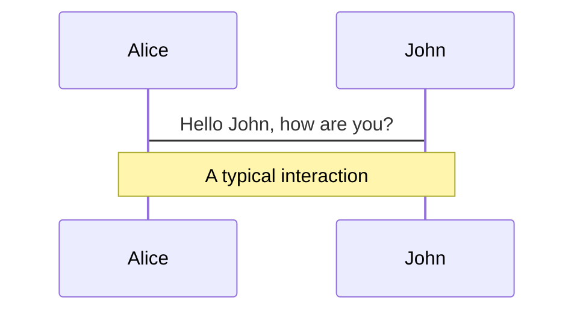
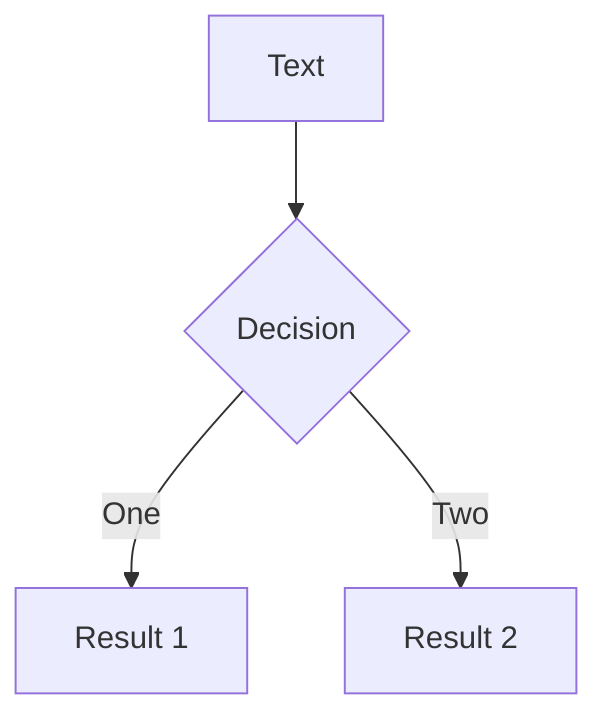
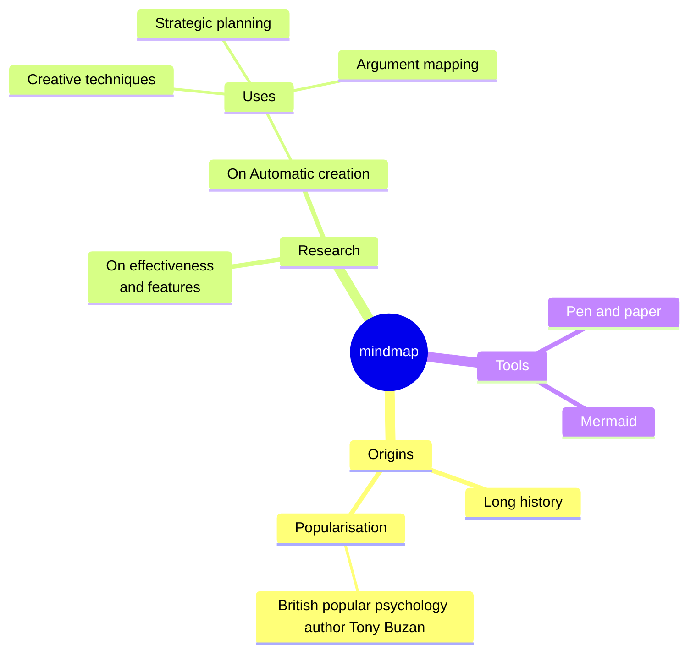
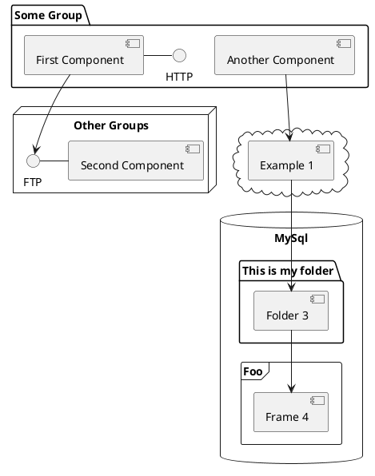

---
# try also 'default' to start simple
theme: seriph
colorSchema: light
layout: lava-cover
# some information about your slides (markdown enabled)
title: Langgraph
info: |
  ## Slidev Starter Template
  Presentation slides for developers.

  Learn more at [Sli.dev](https://sli.dev)
# apply UnoCSS classes to the current slide
class: text-center
# https://sli.dev/features/drawing
drawings:
  persist: false
# slide transition: https://sli.dev/guide/animations.html#slide-transitions
transition: slide-left
# enable Comark Syntax: https://comark.dev/syntax/markdown
comark: true
# duration of the presentation
duration: 35min
---

# LangGraph

Nataly Jaya 


<div class="abs-br m-6 text-xl">
  
  <a href="https://github.com/NatalyJaya/langgraph-exhibition" target="_blank" class="slidev-icon-btn">
    <carbon:logo-github />
  </a>
</div>

<!--
The last comment block of each slide will be treated as slide notes. It will be visible and editable in Presenter Mode along with the slide. [Read more in the docs](https://sli.dev/guide/syntax.html#notes)
-->

---
layout: blank
transition: fade-out
class: h1-gradient
---

<!--
You can have `style` tag in markdown to override the style for the current page.
Learn more: https://sli.dev/features/slide-scope-style
-->
<AntrophicArchitecture :escala="0.9" />

<!--
Here is another comment.
-->

---
layout: lava-cover
transition: fade-out
class: h1-gradient
---

# How can I build a Multi-Agent System?


---
layout: lava-cover
transition: fade-out
class: h1-gradient
---

<div class="flex items-center justify-center gap-10 mt-12">
  

  <span class="text-3xl font-bold text-gray-400">VS</span>

  
</div>


---
layout: blank
transition: view-transition
class: h1-gradient
---

<CrewAI-vs-Langgraph :escala="1" />

---
layout: blank
transition: view-transition
---

<CrewAI-vs-Langgraph :escala="1" variant="crewai">
  <div v-click>
    <CrewAIDiagram />
  </div>
</CrewAI-vs-Langgraph>

---
layout: blank
transition: view-transition
---

<CrewAI-vs-Langgraph :escala="1" />

---
layout: blank
transition: fade-out
---

<CrewAI-vs-Langgraph :escala="1" variant="langgraph">
  <div v-click>
    <LangGraphDiagram />
  </div>
</CrewAI-vs-Langgraph>


---
layout: lava-cover
transition: fade-out
class: h1-gradient
---

# How does LangGraph transform a graph defined by the developer into an executable object? 
## An analysis of the compile() method


---
layout: compile-split
transition: fade
step: '0 · example'
heading: 'Our multi-agent graph, before compile()'
---

```python {1-3|5-8|10-15|17-20}{lines:true}
class State(TypedDict):
    messages: Annotated[list, add_messages]
    next: str

builder = StateGraph(State)
builder.add_node("supervisor", supervisor)
builder.add_node("researcher", researcher)
builder.add_node("writer", writer)

builder.add_edge(START, "supervisor")
builder.add_conditional_edges(
    "supervisor", route, ["researcher", "writer", END]
)
builder.add_edge("researcher", "supervisor")
builder.add_edge("writer", "supervisor")

graph = builder.compile(
    checkpointer=InMemorySaver(),
    interrupt_before=["writer"],
)
```

::right::

<CompileDiagram :click="$clicks" :steps="['b-state', 'b-nodes', 'b-edges', 'b-compile']" />

<!--
A supervisor routes work to a researcher and a writer. Everything here only *describes* the graph: the builder stores specs and tuples.
-->

---
layout: compile-split
transition: fade
step: '1 / 9'
heading: 'Signature & checkpointer'
---

```python {1-12|3,7|14}{lines:false}
def compile(
    self,
    checkpointer: Checkpointer = None,
    *,
    cache: BaseCache | None = None,
    store: BaseStore | None = None,
    interrupt_before: All | list[str] | None = None,
    interrupt_after: All | list[str] | None = None,
    debug: bool = False,
    name: str | None = None,
    transformers: Sequence[Callable[[tuple[str, ...]], Any]] | None = None,
) -> CompiledStateGraph[StateT, ContextT, InputT, OutputT]:
    """Compiles the `StateGraph` into a `CompiledStateGraph` object. (…)"""
    checkpointer = ensure_valid_checkpointer(checkpointer)
```

::right::

<CompileDiagram :click="$clicks" :steps="['b-compile', 'b-args', 'checkpointer']" />

<!--
Docstring collapsed. Our call only uses `checkpointer` and `interrupt_before`. ensure_valid_checkpointer() normalises the value (None / False / a saver).
-->

---
layout: compile-split
transition: fade
step: '2 / 9'
heading: 'Serialization allowlist'
---

```python {57-71|72-75|76-78}{lines:true,startLine:57}
serde_allowlist: set[tuple[str, ...]] | None = None
if _serde.STRICT_MSGPACK_ENABLED:
    schema_types: list[type[Any]] = [
        self.state_schema,
        self.input_schema,
        self.output_schema,
    ]
    if self.context_schema is not None:
        schema_types.append(self.context_schema)
    for node in self.nodes.values():
        schema_types.append(node.input_schema)
    for branches in self.branches.values():
        for branch in branches.values():
            if branch.input_schema is not None:
                schema_types.append(branch.input_schema)
    serde_allowlist = _serde.build_serde_allowlist(
        schemas=schema_types,
        channels=self.channels,
    )
    checkpointer = _serde.apply_checkpointer_allowlist(
        checkpointer, serde_allowlist
    )
```

::right::

<CompileDiagram :click="$clicks" :steps="['serde-collect', 'serde', 'serde-apply']" />

<!--
Only runs when strict msgpack is enabled. It collects the State, input/output/context schemas plus every node and branch input schema, and restricts what the checkpointer may deserialize.
-->

---
layout: compile-split
transition: fade
step: '3 / 9'
heading: 'Defaults & validation'
---

```python {80-82|84-91}{lines:true,startLine:80}
# assign default values
interrupt_before = interrupt_before or []
interrupt_after = interrupt_after or []

# validate the graph
self.validate(
    interrupt=(
        (interrupt_before if interrupt_before != "*" else []) + interrupt_after
        if interrupt_after != "*"
        else []
    )
)
```

::right::

<CompileDiagram :click="$clicks" :steps="['interrupts', 'validate']" />

<!--
validate() checks that every edge points to a known node, that START has an outgoing edge, and that interrupt node names (here "writer") exist.
-->

---
layout: compile-split
transition: fade
step: '4 / 9'
heading: 'Output & stream channels'
---

```python {93-103|104-110}{lines:true,startLine:93}
# prepare output channels
output_channels = (
    "__root__"
    if len(self.schemas[self.output_schema]) == 1
    and "__root__" in self.schemas[self.output_schema]
    else [
        key
        for key, val in self.schemas[self.output_schema].items()
        if not is_managed_value(val)
    ]
)
stream_channels = (
    "__root__"
    if len(self.channels) == 1 and "__root__" in self.channels
    else [
        key for key, val in self.channels.items() if not is_managed_value(val)
    ]
)
```

::right::

<CompileDiagram :click="$clicks" :steps="['output-ch', 'stream-ch']" />

<!--
Decides which channels are returned by invoke() and which are emitted while streaming. Managed values are skipped.
-->

---
layout: compile-split
transition: fade
step: '5 / 9'
heading: 'Builder defaults: default error handler'
---

```python {111-115|116-134}{lines:true,startLine:111}
# Apply builder defaults to node specs. Per-node values always win.
# Error-handler routing and cache_policy are only assigned to regular
# nodes. Retry and timeout defaults also apply to error-handler nodes.
defaults = self._node_defaults
default_handler_name: str | None = None
if defaults.error_handler is not None:
    if _DEFAULT_ERROR_HANDLER_NODE in self.nodes:
        raise ValueError(
            f"Auto-generated default error handler node "
            f"`{_DEFAULT_ERROR_HANDLER_NODE}` already exists."
        )
    default_handler_name = _DEFAULT_ERROR_HANDLER_NODE
    self.nodes[default_handler_name] = StateNodeSpec[Any, ContextT](
        coerce_to_runnable(
            defaults.error_handler,  # type: ignore[arg-type]
            name=default_handler_name,
            trace=False,
        ),
        metadata=None,
        input_schema=self.state_schema,
        retry_policy=None,
        cache_policy=None,
        is_error_handler=True,
    )
```

::right::

<CompileDiagram :click="$clicks" :steps="['h-read', 'h-default']" />

<!--
If the builder has a default error handler, compile() injects an extra node for it. Our example does not set one, so this stays dashed.
-->

---
layout: compile-split
transition: fade
step: '6 / 9'
heading: 'Builder defaults: per-node policies'
---

```python {136-137|138-145|146-149|150-158|159-162}{lines:true,startLine:136}
# Apply builder defaults to node specs. Per-node values always win.
for spec in self.nodes.values():
    # error_handler: regular nodes only — handlers must never
    # catch themselves or other handlers.
    if (
        not spec.is_error_handler
        and default_handler_name is not None
        and spec.error_handler_node is None
    ):
        spec.error_handler_node = default_handler_name
    # retry: all nodes — handlers should be retried on transient
    # failures just like regular nodes.
    if defaults.retry_policy is not None and spec.retry_policy is None:
        spec.retry_policy = defaults.retry_policy
    # cache: regular nodes only — caching an error-handler result
    # is unsafe because the input (failed-node state) may differ
    # across failures even when the cache key matches.
    if (
        not spec.is_error_handler
        and defaults.cache_policy is not None
        and spec.cache_policy is None
    ):
        spec.cache_policy = defaults.cache_policy
    # timeout: all nodes — a stuck handler should be cancelled the
    # same way a stuck regular node would be.
    if defaults.timeout is not None and spec.timeout is None:
        spec.timeout = defaults.timeout
```

::right::

<CompileDiagram :click="$clicks" :steps="['h-loop', 'h-error', 'h-retry', 'h-cache', 'h-timeout']" />

<!--
E = error handler, R = retry, C = cache, T = timeout. Badges are dashed: they only apply when a builder default exists and the node has no value of its own.
-->

---
layout: compile-split
transition: fade
step: '7 / 9'
heading: 'Creating the CompiledStateGraph'
---

```python {164-168|170-175|176-195}{lines:true,startLine:164,maxHeight:'420px'}
node_error_handler_map = {
    node_name: spec.error_handler_node
    for node_name, spec in self.nodes.items()
    if not spec.is_error_handler and spec.error_handler_node is not None
}

compiled = CompiledStateGraph[StateT, ContextT, InputT, OutputT](
    builder=self,
    schema_to_mapper={},
    context_schema=self.context_schema,
    nodes={},
    channels={
        **self.channels,
        **self.managed,
        START: EphemeralValue(self.input_schema),
    },
    input_channels=START,
    stream_mode="updates",
    output_channels=output_channels,
    stream_channels=stream_channels,
    checkpointer=checkpointer,
    interrupt_before_nodes=interrupt_before,
    interrupt_after_nodes=interrupt_after,
    auto_validate=False,
    debug=debug,
    store=store,
    cache=cache,
    node_error_handler_map=node_error_handler_map,
    name=name or "LangGraph",
    stream_transformers=transformers,
)
compiled._serde_allowlist = serde_allowlist
```

::right::

<CompileDiagram :click="$clicks" :steps="['errormap', 'instance', 'instance-cfg']" />

<!--
The Pregel object is created with an empty nodes dict. The builder channels are copied and a new __start__ EphemeralValue channel receives the input.
-->

---
layout: compile-split
transition: fade
step: '8 / 9'
heading: 'Attaching nodes'
---

```python {197|198-199|201-213}{lines:true,startLine:197}
compiled.attach_node(START, None)
for key, node in self.nodes.items():
    compiled.attach_node(key, node)

# Record output/state mappers for v2 stream coercion (pydantic/dataclass only)
compiled._output_mapper = _pick_mapper(
    list(output_channels)
    if isinstance(output_channels, list)
    else [output_channels],
    self.output_schema,
)
compiled._state_mapper = _pick_mapper(
    list(stream_channels)
    if isinstance(stream_channels, list)
    else [stream_channels],
    self.state_schema,
)
```

::right::

<CompileDiagram :click="$clicks" :steps="['start', 'nodes', 'mappers']" />

<!--
attach_node() turns each StateNodeSpec into a PregelNode that subscribes to channels and writes its updates back.
-->

---
layout: compile-split
transition: fade
step: '9 / 9'
heading: 'Attaching edges & branches'
---

```python {215-216|218-219|221-223|225}{lines:true,startLine:215}
for start, end in self.edges:
    compiled.attach_edge(start, end)

for starts, end in self.waiting_edges:
    compiled.attach_edge(starts, end)

for start, branches in self.branches.items():
    for name, branch in branches.items():
        compiled.attach_branch(start, name, branch)

return compiled.validate()
```

::right::

<CompileDiagram :click="$clicks" :steps="['edges', 'waiting', 'branches', 'done']" />

<!--
Edges and branches become channel writes that trigger the next node. compiled.validate() runs the final checks and returns the executable graph.
-->

---
layout: image-right
image: https://cover.sli.dev
---

<LavaBackground />

# Code

Use code snippets and get the highlighting directly, and even types hover!

```ts [filename-example.ts] {all|4|6|6-7|9|all} twoslash
// TwoSlash enables TypeScript hover information
// and errors in markdown code blocks
// More at https://shiki.style/packages/twoslash
import { computed, ref } from 'vue'

const count = ref(0)
const doubled = computed(() => count.value * 2)

doubled.value = 2
```

<arrow v-click="[4, 5]" x1="350" y1="310" x2="195" y2="342" color="#953" width="2" arrowSize="1" />

<!-- This allow you to embed external code blocks -->
<<< @/snippets/external.ts#snippet

<!-- Footer -->

[Learn more](https://sli.dev/features/line-highlighting)

<!--
Notes can also sync with clicks

[click] This will be highlighted after the first click

[click] Highlighted with `count = ref(0)`

[click:3] Last click (skip two clicks)
-->

---
level: 2
---

# Shiki Magic Move

Powered by [shiki-magic-move](https://shiki-magic-move.netlify.app/), Slidev supports animations across multiple code snippets.

Add multiple code blocks and wrap them with <code>````md magic-move</code> (four backticks) to enable the magic move. For example:

````md magic-move {lines: true}
```ts {*|2|*}
// step 1
const author = reactive({
  name: 'John Doe',
  books: [
    'Vue 2 - Advanced Guide',
    'Vue 3 - Basic Guide',
    'Vue 4 - The Mystery'
  ]
})
```

```ts {*|1-2|3-4|3-4,8}
// step 2
export default {
  data() {
    return {
      author: {
        name: 'John Doe',
        books: [
          'Vue 2 - Advanced Guide',
          'Vue 3 - Basic Guide',
          'Vue 4 - The Mystery'
        ]
      }
    }
  }
}
```

```ts
// step 3
export default {
  data: () => ({
    author: {
      name: 'John Doe',
      books: [
        'Vue 2 - Advanced Guide',
        'Vue 3 - Basic Guide',
        'Vue 4 - The Mystery'
      ]
    }
  })
}
```

Non-code blocks are ignored.

```vue
<!-- step 4 -->
<script setup>
const author = {
  name: 'John Doe',
  books: [
    'Vue 2 - Advanced Guide',
    'Vue 3 - Basic Guide',
    'Vue 4 - The Mystery'
  ]
}
</script>
```
````

---

# Components

<div grid="~ cols-2 gap-4">
<div>

You can use Vue components directly inside your slides.

We have provided a few built-in components like `<Tweet/>`, `<BlueSky/>`, and `<Youtube/>` that you can use directly. And adding your custom components is also super easy.

```html
<Counter :count="10" />
```

<!-- ./components/Counter.vue -->
<Counter :count="10" m="t-4" />

Check out [the guides](https://sli.dev/builtin/components.html) for more.

</div>
<div>

```html
<Tweet id="1390115482657726468" />
```

<Tweet id="1390115482657726468" scale="0.65" />

</div>
</div>

<!--
Presenter note with **bold**, *italic*, and ~~striked~~ text.

Also, HTML elements are valid:
<div class="flex w-full">
  <span style="flex-grow: 1;">Left content</span>
  <span>Right content</span>
</div>
-->

---
class: px-20
---

# Themes

Slidev comes with powerful theming support. Themes can provide styles, layouts, components, or even configurations for tools. Switching between themes by just **one edit** in your frontmatter:

<div grid="~ cols-2 gap-2" m="t-2">

```yaml
---
theme: default
---
```

```yaml
---
theme: seriph
---
```


</div>

Read more about [How to use a theme](https://sli.dev/guide/theme-addon#use-theme) and
check out the [Awesome Themes Gallery](https://sli.dev/resources/theme-gallery).

---

# Clicks Animations

You can add `v-click` to elements to add a click animation.

<div v-click>

This shows up when you press <kbd>space</kbd> or <kbd>right</kbd>, or click outside the slide on the right.

```html
<div v-click>This shows up when you trigger a click animation.</div>
```

</div>

<p v-click>
You can also add modifiers to change the animation:
</p>

<div class="grid gap-3 mt-4 text-sm" style="grid-template-columns: repeat(3, 1fr) 1.5fr 1fr">
  <div v-after.up class="p-3 rounded border border-primary/20 bg-primary/10">
    <div class="font-mono text-xs opacity-60 mb-1">v-click.up</div>
    <div>Slide from bottom</div>
  </div>
  <div v-click.fade-in class="p-3 rounded border border-primary/30 bg-primary/15">
    <div class="font-mono text-xs opacity-60 mb-1">v-click.fade-in</div>
    <div>Fade in</div>
  </div>
  <div v-click.fade class="p-3 rounded border border-primary/40 bg-primary/20">
    <div class="font-mono text-xs opacity-60 mb-1">v-click.fade</div>
    <div>Dim (0.5 opacity)</div>
  </div>
  <div v-click.fade.right.scale class="p-3 rounded border border-primary/50 bg-primary/25">
    <div class="font-mono text-xs opacity-60 mb-1">v-click.fade.right.scale</div>
    <div>Composed</div>
  </div>
  <div v-click.none class="p-3 rounded border border-primary/60 bg-primary/30">
    <div class="font-mono text-xs opacity-60 mb-1">v-click.none</div>
    <div>No transition</div>
  </div>
</div>

<v-click>

The <span v-mark.red="7"><code>v-mark</code> directive</span>
also allows you to add
<span v-mark.circle.orange="8">inline marks</span>
, powered by [Rough Notation](https://roughnotation.com/):

```html
<span v-mark.underline.orange>inline markers</span>
```

</v-click>

<div v-click mt-12>

[Learn more](https://sli.dev/guide/animations#click-animation)

</div>

---

# Motions

Motion animations are powered by [@vueuse/motion](https://motion.vueuse.org/), triggered by `v-motion` directive.

```html
<div
  v-motion
  :initial="{ x: -80 }"
  :enter="{ x: 0 }"
  :click-3="{ x: 80 }"
  :leave="{ x: 1000 }"
>
  Slidev
</div>
```

<div class="w-60 relative">
  <div class="relative w-40 h-40">
    
    
    
  </div>

  <div
    class="text-5xl absolute top-14 left-40 text-[#2B90B6] -z-1"
    v-motion
    :initial="{ x: -80, opacity: 0}"
    :enter="{ x: 0, opacity: 1, transition: { delay: 2000, duration: 1000 } }">
    Slidev
  </div>
</div>

<!-- vue script setup scripts can be directly used in markdown, and will only affects current page -->
<script setup lang="ts">
const final = {
  x: 0,
  y: 0,
  rotate: 0,
  scale: 1,
  transition: {
    type: 'spring',
    damping: 10,
    stiffness: 20,
    mass: 2
  }
}
</script>

<div
  v-motion
  :initial="{ x:35, y: 30, opacity: 0}"
  :enter="{ y: 0, opacity: 1, transition: { delay: 3500 } }">

[Learn more](https://sli.dev/guide/animations.html#motion)

</div>

---

# $\LaTeX$

$\LaTeX$ is supported out-of-box. Powered by [$\KaTeX$](https://katex.org/).

<div h-3 />

Inline $\sqrt{3x-1}+(1+x)^2$

Block
$$ {1|3|all}
\begin{aligned}
\nabla \cdot \vec{E} &= \frac{\rho}{\varepsilon_0} \\
\nabla \cdot \vec{B} &= 0 \\
\nabla \times \vec{E} &= -\frac{\partial\vec{B}}{\partial t} \\
\nabla \times \vec{B} &= \mu_0\vec{J} + \mu_0\varepsilon_0\frac{\partial\vec{E}}{\partial t}
\end{aligned}
$$

[Learn more](https://sli.dev/features/latex)

---

# Diagrams

You can create diagrams / graphs from textual descriptions, directly in your Markdown.

<div class="grid grid-cols-4 gap-5 pt-4 -mb-6">









</div>

Learn more: [Mermaid Diagrams](https://sli.dev/features/mermaid) and [PlantUML Diagrams](https://sli.dev/features/plantuml)

---
foo: bar
dragPos:
  square: -48,0,0,0
---

# Draggable Elements

Double-click on the draggable elements to edit their positions.

<br>

###### Directive Usage

```md

```

<br>

###### Component Usage

```md
<v-drag text-3xl>
  <div class="i-carbon:arrow-up" />
  Use the `v-drag` component to have a draggable container!
</v-drag>
```

<v-drag pos="663,206,261,_,-15">
  <div text-center text-3xl border border-main rounded>
    Double-click me!
  </div>
</v-drag>


###### Draggable Arrow

```md
<v-drag-arrow two-way />
```

<v-drag-arrow pos="67,452,253,46" two-way op70 />

---
src: ./pages/imported-slides.md
hide: false
---

---

# Monaco Editor

Slidev provides built-in Monaco Editor support.

Add `{monaco}` to the code block to turn it into an editor:

```ts {monaco}
import { ref } from 'vue'
import { emptyArray } from './external'

const arr = ref(emptyArray(10))
```

Use `{monaco-run}` to create an editor that can execute the code directly in the slide:

```ts {monaco-run}
import { version } from 'vue'
import { emptyArray, sayHello } from './external'

sayHello()
console.log(`vue ${version}`)
console.log(emptyArray<number>(10).reduce(fib => [...fib, fib.at(-1)! + fib.at(-2)!], [1, 1]))
```

---
layout: center
class: text-center
---

<LavaBackground />

# Learn More

[Documentation](https://sli.dev) · [GitHub](https://github.com/slidevjs/slidev) · [Showcases](https://sli.dev/resources/showcases)

<PoweredBySlidev mt-10 />
