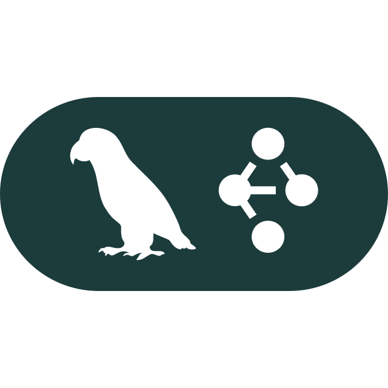

---
# try also 'default' to start simple
theme: seriph
colorSchema: light
layout: lava-cover
# some information about your slides (markdown enabled)
title: Langgraph
info: |
  ## Slidev Starter Template
  Presentation slides for developers.

  Learn more at [Sli.dev](https://sli.dev)
# apply UnoCSS classes to the current slide
class: text-center
# https://sli.dev/features/drawing
drawings:
  persist: false
# slide transition: https://sli.dev/guide/animations.html#slide-transitions
transition: soft-rise | soft-fall
# enable Comark Syntax: https://comark.dev/syntax/markdown
comark: true
# duration of the presentation
duration: 35min
---

# LangGraph

Nataly Jaya 


<div class="abs-br m-6 text-xl">
  
  <a href="https://github.com/NatalyJaya/langgraph-exhibition" target="_blank" class="slidev-icon-btn">
    <carbon:logo-github />
  </a>
</div>

<!--
The last comment block of each slide will be treated as slide notes. It will be visible and editable in Presenter Mode along with the slide. [Read more in the docs](https://sli.dev/guide/syntax.html#notes)
-->

---
layout: lava-cover
transition: fade-out
class: h1-gradient
---

<div class="toc">
  <div class="toc-intro">
    <span class="toc-eyebrow">OVERVIEW</span>
    <h1>Contents</h1>
    <p class="toc-lead">
      From multi-agent fundamentals to the internals of LangGraph's compiler.
    </p>
  </div>

  <ol class="toc-list">
    <li class="toc-item">
      <span class="toc-num">01</span>
      <div>
        <h3>Birth of Multi-Agent System</h3>
        <p>Anthropic artice.</p>
      </div>
    </li>
    <li class="toc-item">
      <span class="toc-num">02</span>
      <div>
        <h3>CrewAI vs. LangGraph</h3>
        <p>Two orchestration frameworks compared side by side.</p>
      </div>
    </li>
    <li class="toc-item">
      <span class="toc-num">03</span>
      <div>
        <h3>Inside LangGraph's <code>compile()</code></h3>
        <p>How a developer-defined graph becomes an executable object.</p>
      </div>
    </li>
    <li class="toc-item">
      <span class="toc-num">04</span>
      <div>
        <h3>Study Conclusions</h3>
        <p>Key takeaways from the analysis.</p>
      </div>
    </li>
    <li class="toc-item">
      <span class="toc-num">05</span>
      <div>
        <h3>Bibliography</h3>
        <p>References and further reading.</p>
      </div>
    </li>
  </ol>
</div>


---
layout: blank
transition: fade-out
class: h1-gradient
---

<!--
You can have `style` tag in markdown to override the style for the current page.
Learn more: https://sli.dev/features/slide-scope-style
-->
<AntrophicArchitecture :escala="0.9" />

<!--
Here is another comment.
-->

---
layout: lava-cover
transition: fade-out
class: h1-gradient
---

# How can I build a Multi-Agent System?


---
layout: lava-cover
transition: fade-out
class: h1-gradient
---

<div class="flex items-center justify-center gap-10 mt-12">
  

  <span class="text-3xl font-bold text-gray-400">VS</span>

  
</div>

---
layout: blank
transition: view-transition
class: h1-gradient
---

<CrewAI-vs-Langgraph :escala="1" />

---
layout: blank
transition: view-transition
---

<CrewAI-vs-Langgraph :escala="1" variant="crewai">
  <div v-click>
    <CrewAIDiagram />
  </div>
</CrewAI-vs-Langgraph>

---
layout: blank
transition: view-transition
---

<CrewAI-vs-Langgraph :escala="1" />

---
layout: blank
transition: fade-out
---

<CrewAI-vs-Langgraph :escala="1" variant="langgraph">
  <div v-click>
    <LangGraphDiagram />
  </div>
</CrewAI-vs-Langgraph>


---
layout: lava-cover
transition: zoom-in | zoom-out
class: h1-gradient
---

# How does LangGraph transform a graph defined by the developer into an executable object? 
## An analysis of the compile() method


---
layout: compile-split
transition: fade
step: '0 · example'
heading: 'Our multi-agent graph, before compile()'
---

```python {1-3|5-8|10-15|17-20}{lines:true}
class State(TypedDict):
    messages: Annotated[list, add_messages]
    next: str

builder = StateGraph(State)
builder.add_node("supervisor", supervisor)
builder.add_node("researcher", researcher)
builder.add_node("writer", writer)

builder.add_edge(START, "supervisor")
builder.add_conditional_edges(
    "supervisor", route, ["researcher", "writer", END]
)
builder.add_edge("researcher", "supervisor")
builder.add_edge("writer", "supervisor")

graph = builder.compile(
    checkpointer=InMemorySaver(),
    interrupt_before=["writer"],
)
```

::right::

<CompileDiagram :click="$clicks" :steps="['b-state', 'b-nodes', 'b-edges', 'b-compile']" />

<!--
A supervisor routes work to a researcher and a writer. Everything here only *describes* the graph: the builder stores specs and tuples.
-->

---
layout: compile-split
transition: fade
step: '1 / 9'
heading: 'Signature & checkpointer'
---

```python {1-12|3,7|14}{lines:false}
def compile(
    self,
    checkpointer: Checkpointer = None,
    *,
    cache: BaseCache | None = None,
    store: BaseStore | None = None,
    interrupt_before: All | list[str] | None = None,
    interrupt_after: All | list[str] | None = None,
    debug: bool = False,
    name: str | None = None,
    transformers: Sequence[Callable[[tuple[str, ...]], Any]] | None = None,
) -> CompiledStateGraph[StateT, ContextT, InputT, OutputT]:
    """Compiles the `StateGraph` into a `CompiledStateGraph` object. (…)"""
    checkpointer = ensure_valid_checkpointer(checkpointer)
```

::right::

<CompileDiagram :click="$clicks" :steps="['b-compile', 'b-args', 'checkpointer']" />

<!--
Docstring collapsed. Our call only uses `checkpointer` and `interrupt_before`. ensure_valid_checkpointer() normalises the value (None / False / a saver).
-->

---
layout: compile-split
transition: fade
step: '2 / 9'
heading: 'Serialization allowlist'
---

```python {57-71|72-75|76-78}{lines:true,startLine:57}
serde_allowlist: set[tuple[str, ...]] | None = None
if _serde.STRICT_MSGPACK_ENABLED:
    schema_types: list[type[Any]] = [
        self.state_schema,
        self.input_schema,
        self.output_schema,
    ]
    if self.context_schema is not None:
        schema_types.append(self.context_schema)
    for node in self.nodes.values():
        schema_types.append(node.input_schema)
    for branches in self.branches.values():
        for branch in branches.values():
            if branch.input_schema is not None:
                schema_types.append(branch.input_schema)
    serde_allowlist = _serde.build_serde_allowlist(
        schemas=schema_types,
        channels=self.channels,
    )
    checkpointer = _serde.apply_checkpointer_allowlist(
        checkpointer, serde_allowlist
    )
```

::right::

<CompileDiagram :click="$clicks" :steps="['serde-collect', 'serde', 'serde-apply']" />

<!--
Only runs when strict msgpack is enabled. It collects the State, input/output/context schemas plus every node and branch input schema, and restricts what the checkpointer may deserialize.
-->

---
layout: compile-split
transition: fade
step: '3 / 9'
heading: 'Defaults & validation'
---

```python {80-82|84-91}{lines:true,startLine:80}
# assign default values
interrupt_before = interrupt_before or []
interrupt_after = interrupt_after or []

# validate the graph
self.validate(
    interrupt=(
        (interrupt_before if interrupt_before != "*" else []) + interrupt_after
        if interrupt_after != "*"
        else []
    )
)
```

::right::

<CompileDiagram :click="$clicks" :steps="['interrupts', 'validate']" />

<!--
validate() checks that every edge points to a known node, that START has an outgoing edge, and that interrupt node names (here "writer") exist.
-->

---
layout: compile-split
transition: fade
step: '4 / 9'
heading: 'Output & stream channels'
---

```python {93-103|104-110}{lines:true,startLine:93}
# prepare output channels
output_channels = (
    "__root__"
    if len(self.schemas[self.output_schema]) == 1
    and "__root__" in self.schemas[self.output_schema]
    else [
        key
        for key, val in self.schemas[self.output_schema].items()
        if not is_managed_value(val)
    ]
)
stream_channels = (
    "__root__"
    if len(self.channels) == 1 and "__root__" in self.channels
    else [
        key for key, val in self.channels.items() if not is_managed_value(val)
    ]
)
```

::right::

<CompileDiagram :click="$clicks" :steps="['output-ch', 'stream-ch']" />

<!--
Decides which channels are returned by invoke() and which are emitted while streaming. Managed values are skipped.
-->

---
layout: compile-split
transition: fade
step: '5 / 9'
heading: 'Builder defaults: default error handler'
---

```python {111-115|116-134}{lines:true,startLine:111}
# Apply builder defaults to node specs. Per-node values always win.
# Error-handler routing and cache_policy are only assigned to regular
# nodes. Retry and timeout defaults also apply to error-handler nodes.
defaults = self._node_defaults
default_handler_name: str | None = None
if defaults.error_handler is not None:
    if _DEFAULT_ERROR_HANDLER_NODE in self.nodes:
        raise ValueError(
            f"Auto-generated default error handler node "
            f"`{_DEFAULT_ERROR_HANDLER_NODE}` already exists."
        )
    default_handler_name = _DEFAULT_ERROR_HANDLER_NODE
    self.nodes[default_handler_name] = StateNodeSpec[Any, ContextT](
        coerce_to_runnable(
            defaults.error_handler,  # type: ignore[arg-type]
            name=default_handler_name,
            trace=False,
        ),
        metadata=None,
        input_schema=self.state_schema,
        retry_policy=None,
        cache_policy=None,
        is_error_handler=True,
    )
```

::right::

<CompileDiagram :click="$clicks" :steps="['h-read', 'h-default']" />

<!--
If the builder has a default error handler, compile() injects an extra node for it. Our example does not set one, so this stays dashed.
-->

---
layout: compile-split
transition: fade
step: '6 / 9'
heading: 'Builder defaults: per-node policies'
---

```python {136-137|138-145|146-149|150-158|159-162}{lines:true,startLine:136}
# Apply builder defaults to node specs. Per-node values always win.
for spec in self.nodes.values():
    # error_handler: regular nodes only — handlers must never
    # catch themselves or other handlers.
    if (
        not spec.is_error_handler
        and default_handler_name is not None
        and spec.error_handler_node is None
    ):
        spec.error_handler_node = default_handler_name
    # retry: all nodes — handlers should be retried on transient
    # failures just like regular nodes.
    if defaults.retry_policy is not None and spec.retry_policy is None:
        spec.retry_policy = defaults.retry_policy
    # cache: regular nodes only — caching an error-handler result
    # is unsafe because the input (failed-node state) may differ
    # across failures even when the cache key matches.
    if (
        not spec.is_error_handler
        and defaults.cache_policy is not None
        and spec.cache_policy is None
    ):
        spec.cache_policy = defaults.cache_policy
    # timeout: all nodes — a stuck handler should be cancelled the
    # same way a stuck regular node would be.
    if defaults.timeout is not None and spec.timeout is None:
        spec.timeout = defaults.timeout
```

::right::

<CompileDiagram :click="$clicks" :steps="['h-loop', 'h-error', 'h-retry', 'h-cache', 'h-timeout']" />

<!--
E = error handler, R = retry, C = cache, T = timeout. Badges are dashed: they only apply when a builder default exists and the node has no value of its own.
-->

---
layout: compile-split
transition: fade
step: '7 / 9'
heading: 'Creating the CompiledStateGraph'
---

```python {164-168|170-175|176-195}{lines:true,startLine:164,maxHeight:'420px'}
node_error_handler_map = {
    node_name: spec.error_handler_node
    for node_name, spec in self.nodes.items()
    if not spec.is_error_handler and spec.error_handler_node is not None
}

compiled = CompiledStateGraph[StateT, ContextT, InputT, OutputT](
    builder=self,
    schema_to_mapper={},
    context_schema=self.context_schema,
    nodes={},
    channels={
        **self.channels,
        **self.managed,
        START: EphemeralValue(self.input_schema),
    },
    input_channels=START,
    stream_mode="updates",
    output_channels=output_channels,
    stream_channels=stream_channels,
    checkpointer=checkpointer,
    interrupt_before_nodes=interrupt_before,
    interrupt_after_nodes=interrupt_after,
    auto_validate=False,
    debug=debug,
    store=store,
    cache=cache,
    node_error_handler_map=node_error_handler_map,
    name=name or "LangGraph",
    stream_transformers=transformers,
)
compiled._serde_allowlist = serde_allowlist
```

::right::

<CompileDiagram :click="$clicks" :steps="['errormap', 'instance', 'instance-cfg']" />

<!--
The Pregel object is created with an empty nodes dict. The builder channels are copied and a new __start__ EphemeralValue channel receives the input.
-->

---
layout: compile-split
transition: fade
step: '8 / 9'
heading: 'Attaching nodes'
---

```python {197|198-199|201-213}{lines:true,startLine:197}
compiled.attach_node(START, None)
for key, node in self.nodes.items():
    compiled.attach_node(key, node)

# Record output/state mappers for v2 stream coercion (pydantic/dataclass only)
compiled._output_mapper = _pick_mapper(
    list(output_channels)
    if isinstance(output_channels, list)
    else [output_channels],
    self.output_schema,
)
compiled._state_mapper = _pick_mapper(
    list(stream_channels)
    if isinstance(stream_channels, list)
    else [stream_channels],
    self.state_schema,
)
```

::right::

<CompileDiagram :click="$clicks" :steps="['start', 'nodes', 'mappers']" />

<!--
attach_node() turns each StateNodeSpec into a PregelNode that subscribes to channels and writes its updates back.
-->

---
layout: compile-split
transition: fade
step: '9 / 9'
heading: 'Attaching edges & branches'
---

```python {215-216|218-219|221-223|225}{lines:true,startLine:215}
for start, end in self.edges:
    compiled.attach_edge(start, end)

for starts, end in self.waiting_edges:
    compiled.attach_edge(starts, end)

for start, branches in self.branches.items():
    for name, branch in branches.items():
        compiled.attach_branch(start, name, branch)

return compiled.validate()
```

::right::

<CompileDiagram :click="$clicks" :steps="['edges', 'waiting', 'branches', 'done']" />

<!--
Edges and branches become channel writes that trigger the next node. compiled.validate() runs the final checks and returns the executable graph.
-->

---
layout: lava-cover
transition: fade-out
class: h1-gradient
---

# Study Conclusions

---
layout: lava-cover
transition: fade-out
class: h1-gradient
---

<div class="biblio">
  <div class="biblio-intro">
    <span class="biblio-eyebrow">REFERENCES</span>
    <h1>Bibliography</h1>
    <p class="biblio-lead">
      Sources and further reading used throughout this presentation.
    </p>
  </div>
  <ol class="biblio-list">
    <li class="biblio-item">
      <p class="biblio-cite">
        Anthropic. (2025, June 13).
        <em>How we built our multi-agent research system</em>.
      </p>
      <a
        class="biblio-url"
        href="https://www.anthropic.com/research/multi-agent-research-system"
        target="_blank"
        rel="noreferrer"
      >https://www.anthropic.com/research/multi-agent-research-system</a>
    </li>
    <li class="biblio-item">
      <p class="biblio-cite">
        DeepWiki.
        <em>How does the compile() method work?</em>
        [Search results].
      </p>
      <a
        class="biblio-url"
        href="https://deepwiki.com/search/como-funciona-el-metodo-compil_e1551da3-6ba4-400d-90f1-e3030c0729e9"
        target="_blank"
        rel="noreferrer"
      >https://deepwiki.com/search/como-funciona-el-metodo-compil_e1551da3-6ba4-400d-90f1-e3030c0729e9</a>
    </li>
    <li class="biblio-item">
      <p class="biblio-cite">
        LangChain.
        <em>langchain-ai/langgraph</em>
        [GitHub repository].
      </p>
      <a
        class="biblio-url"
        href="https://github.com/langchain-ai/langgraph"
        target="_blank"
        rel="noreferrer"
      >https://github.com/langchain-ai/langgraph</a>
    </li>
    <li class="biblio-item">
      <p class="biblio-cite">
        Alejandro AO. (2025, June 19).
        <em>Anthropic: How to build multi agent systems</em>
        [Video]. YouTube.
      </p>
      <a
        class="biblio-url"
        href="https://youtu.be/0HljLKVdtjo?si=uMpA7nDYzHYQZUiQ"
        target="_blank"
        rel="noreferrer"
      >https://youtu.be/0HljLKVdtjo?si=uMpA7nDYzHYQZUiQ</a>
    </li>
    <li class="biblio-item">
      <p class="biblio-cite">
        TrueFoundry.
        <em>CrewAI vs. LangGraph: Know the differences</em>
        [Blog post].
      </p>
      <a
        class="biblio-url"
        href="https://www.truefoundry.com/blog/crewai-vs-langgraph"
        target="_blank"
        rel="noreferrer"
      >https://www.truefoundry.com/blog/crewai-vs-langgraph</a>
    </li>
    <li class="biblio-item">
      <p class="biblio-cite">
        Personal-Demo-Multi-Agent-System.
        <em>Example</em>
        [GitHub repository].
      </p>
      <a
        class="biblio-url"
        href="https://github.com/NatalyJaya/Personal-Demo-Multi-Agent-System"
        target="_blank"
        rel="noreferrer"
      >https://github.com/NatalyJaya/Personal-Demo-Multi-Agent-System</a>
    </li>
  </ol>
</div>
